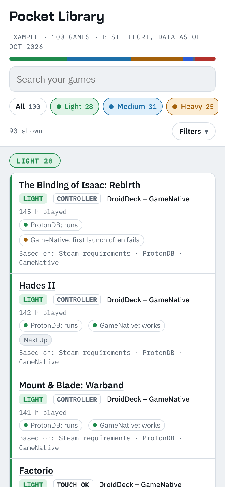
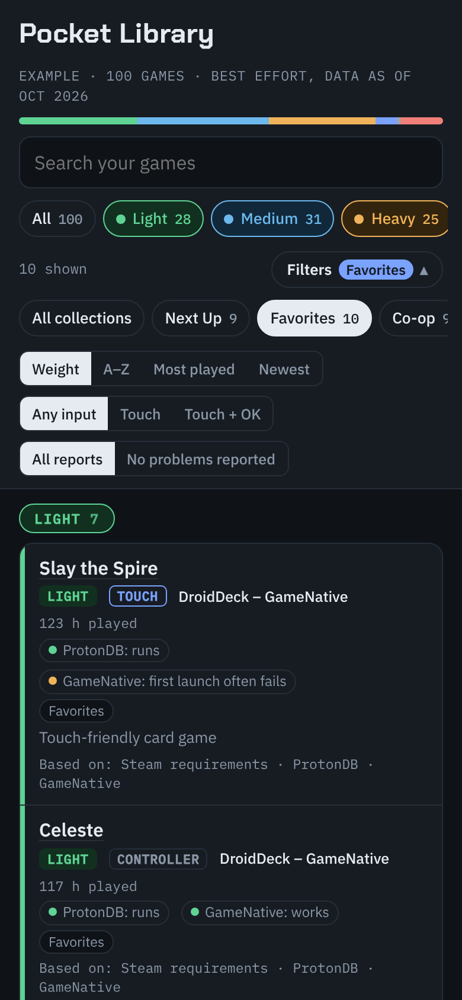

# Pocket Library

By [notadevperse](https://github.com/notadevperse) · [github.com/notadevperse/pocket-library](https://github.com/notadevperse/pocket-library)

Check which of your Steam games you can play on an Android phone or handheld (an AYN Odin or Thor, a Retroid Pocket, an Anbernic, and so on) with **DroidDeck**, **GameNative**, or **GameHub Lite**. You get a page with every game in your library: how demanding it is, what players report, and how well it plays with touch, filterable by your Steam collections and playtime.

**Try it: [notadevperse.github.io/pocket-library](https://notadevperse.github.io/pocket-library/)**. Tap **Try an example library** to see it straight away, or open your own Steam files.

<p>


</p>

- Free, no account, no install. Works in any recent browser, on a phone or a computer.
- **Your files stay on your device.** The page reads them in your browser and remembers your library in that browser only. Nothing is uploaded, and the page contacts no other site: there are no analytics, and the fonts are bundled with it.
- It's plain HTML and JavaScript with no build step. [View the source](index.html) if you want to check.
- Best effort at the time of publishing: built from public data, never from tests. See [Limitations](#limitations).
- Claude is optional. With Claude, you can keep a private copy of your page in Claude and have it judge games that have no data yet. See [Using Claude](#using-claude-optional).

## 1. Get your games list (on a computer)

Each option is a bookmark that works on a Steam or GOG page you already have open and saves a file to your Downloads. It sends nothing anywhere, and the file holds no account ID. Use option 1, option 2, or both: option 1 gives playtime, and option 2 adds the date you got each game. Option 3 adds your wishlist, and option 4 your GOG games. The readable code for all four is in [`pocket-library/bookmarks/`](pocket-library/bookmarks).

**Option 1: games and playtime.** Works on your own games page even if your profile is private.

1. Copy this code:

<!-- bm-games -->
```
javascript:(() => { const help = 'Open your Steam games page first (steamcommunity.com/my/games/?tab=all), wait for your games to show, then click this bookmark again.'; function save(fileName, data) { const link = document.createElement('a'); link.href = URL.createObjectURL(new Blob([JSON.stringify(data)], { type: 'application/json' })); link.download = fileName; document.body.appendChild(link); link.click(); link.remove(); } try { const pageData = JSON.parse(window.SSR.renderContext.queryData); const owned = pageData.queries.find(q => q.queryKey[0] === 'OwnedGames'); const games = owned.state.data.map(g => ({ appid: g.appid, name: g.name, minutes: g.playtime_forever || 0 })); save('steam-games.json', { source: 'pocket-library', kind: 'games', saved: new Date().toISOString(), games: games }); } catch (err) { alert(help); } })();
```
<!-- /bm-games -->

2. In Chrome or Edge, right-click the bookmarks bar, choose **Add page**, name it **Get my Steam games**, and paste the code into the **URL** box. Save.
3. Open `steamcommunity.com/my/games/?tab=all`, sign in if asked, and wait for your games to show.
4. Click the bookmark. It saves `steam-games.json`.

**Option 2: licenses, with dates.** Lets the page sort by newest. Steam shows licenses 100 to a page, so it reads each page in turn, which takes a few seconds. It has no playtime, and some licenses are bundles or extras rather than games, so only the ones that match a game are used.

1. Copy this code:

<!-- bm-licenses -->
```
javascript:(async () => { const help = 'Open store.steampowered.com/account/licenses/ while signed in to Steam, then click this bookmark again.'; const pauseMs = 400; const maxPages = 200; function save(fileName, data) { const link = document.createElement('a'); link.href = URL.createObjectURL(new Blob([JSON.stringify(data)], { type: 'application/json' })); link.download = fileName; document.body.appendChild(link); link.click(); link.remove(); } function isoDate(text) { const d = new Date(text); if (isNaN(d)) { return text; } const two = n => String(n).padStart(2, '0'); return d.getFullYear() + '-' + two(d.getMonth() + 1) + '-' + two(d.getDate()); } function licensesOn(page) { const rows = [...page.querySelectorAll('table.account_table tr')].filter(r => r.querySelector('td.license_date_col')); return rows.map(row => { const cells = row.querySelectorAll('td'); const nameCell = cells[1].cloneNode(true); nameCell.querySelectorAll('div').forEach(d => d.remove()); const method = row.querySelector('td.license_acquisition_col'); return { name: nameCell.textContent.replace(/\s+/g, ' ').trim(), date: isoDate(cells[0].textContent.trim()), method: method ? method.textContent.trim() : '' }; }); } let page = document; let licenses = licensesOn(page); if (!licenses.length) { alert(help); return; } const seen = new Set([location.href]); for (let n = 1; n < maxPages; n++) { const next = page.querySelector('a.license_paginator_next'); const url = next && next.href; if (!url || seen.has(url)) { break; } seen.add(url); await new Promise(done => setTimeout(done, pauseMs)); const response = await fetch(url, { credentials: 'same-origin' }); page = new DOMParser().parseFromString(await response.text(), 'text/html'); const more = licensesOn(page); if (!more.length) { break; } licenses = licenses.concat(more); } save('steam-licenses.json', { source: 'pocket-library', kind: 'licenses', saved: new Date().toISOString(), licenses: licenses }); })();
```
<!-- /bm-licenses -->

2. Add it as a bookmark the same way, named **Get my Steam licenses**.
3. Open `store.steampowered.com/account/licenses/` and sign in if asked.
4. Click the bookmark. It saves `steam-licenses.json`.

**Option 3: your wishlist.** Shows which games on your Steam wishlist could run on your device, before you buy them. It asks the Steam store for your own wishlist (one request, the same one the store makes to mark wishlisted games). The file holds only the games' Steam numbers; games outside Pocket Library's list show as Unknown.

1. Copy this code:

<!-- bm-wishlist -->
```
javascript:(async () => { const help = 'Open store.steampowered.com while signed in to Steam, then click this bookmark again.'; function save(fileName, data) { const link = document.createElement('a'); link.href = URL.createObjectURL(new Blob([JSON.stringify(data)], { type: 'application/json' })); link.download = fileName; document.body.appendChild(link); link.click(); link.remove(); } try { if (location.hostname !== 'store.steampowered.com') { throw new Error('not on the store'); } const response = await fetch('/dynamicstore/userdata/', { credentials: 'same-origin', cache: 'no-store' }); const data = await response.json(); const wishlist = [...new Set((data.rgWishlist || []).map(String))]; if (!wishlist.length) { alert('No wishlist found. Your wishlist may be empty, or you may not be signed in. ' + help); return; } save('steam-wishlist.json', { source: 'pocket-library', kind: 'wishlist', saved: new Date().toISOString(), wishlist: wishlist }); } catch (err) { alert(help); } })();
```
<!-- /bm-wishlist -->

2. Add it as a bookmark the same way, named **Get my Steam wishlist**.
3. Open `store.steampowered.com` and sign in if asked.
4. Click the bookmark. It saves `steam-wishlist.json`.

**Option 4: your GOG games.** Adds the games in your GOG library, matched to Pocket Library's list by name and tagged GOG. A game you own on both stores shows once. DroidDeck and GameNative can sign in to GOG and load your library. GameHub Lite's GOG support isn't documented, so it isn't suggested for games you own only on GOG. It asks GOG for your own library, 100 games to a page, with a short pause between pages. GOG has no playtime to share, and games whose names don't match show as Unknown.

1. Copy this code:

<!-- bm-gog -->
```
javascript:(async () => { const help = 'Open www.gog.com while signed in to GOG, then click this bookmark again.'; const pauseMs = 400; const maxPages = 100; function save(fileName, data) { const link = document.createElement('a'); link.href = URL.createObjectURL(new Blob([JSON.stringify(data)], { type: 'application/json' })); link.download = fileName; document.body.appendChild(link); link.click(); link.remove(); } if (location.hostname !== 'www.gog.com') { alert(help); return; } let games = []; try { for (let page = 1; page <= maxPages; page++) { if (page > 1) { await new Promise(done => setTimeout(done, pauseMs)); } const response = await fetch('/account/getFilteredProducts?mediaType=1&page=' + page, { credentials: 'same-origin' }); const data = await response.json(); games = games.concat((data.products || []).map(p => ({ id: String(p.id), name: String(p.title || '') }))); if (!data.totalPages || page >= data.totalPages) { break; } } } catch (err) { alert(help); return; } if (!games.length) { alert('No GOG games found. Your library may be empty, or you may not be signed in. ' + help); return; } save('gog-games.json', { source: 'pocket-library', kind: 'gog', saved: new Date().toISOString(), games: games }); })();
```
<!-- /bm-gog -->

2. Add it as a bookmark the same way, named **Get my GOG games**.
3. Open `www.gog.com` and sign in if asked.
4. Click the bookmark. It saves `gog-games.json`.

**Optional: your Steam collections.** They're in a file called `cloud-storage-namespace-1.json` on the same computer:

- Windows: `C:\Program Files (x86)\Steam\userdata\<number>\config\cloudstorage\`
- Mac: `~/Library/Application Support/Steam/userdata/<number>/config/cloudstorage/`
- Linux / Steam Deck: `~/.steam/steam/userdata/<number>/config/cloudstorage/`

If there are several numbered folders, use the newest.

## 2. Open them on the website

1. Go to [notadevperse.github.io/pocket-library](https://notadevperse.github.io/pocket-library/).
2. Pick your device type: recent Snapdragon, older Snapdragon, or not Snapdragon. Not sure? Find your model in **Settings → About phone**, then search for its name plus "chipset".
3. Tap **Open my files** and pick `steam-games.json` and/or `steam-licenses.json`, plus your collections, wishlist, and GOG files if you want them. With a wishlist, **My games** and **Wishlist** at the top switch between the two. You can also drag the files onto the page.

That's it. Next time you open the website, your library is still there. Open new files to update it, or tap **Save a copy of this page** to keep a file that works offline. The game data is refreshed once a month, and games that changed in the latest data say what changed.

To use your library on your phone too, open the files there (send them to yourself), or open the saved copy.

## Using Claude (optional)

Pocket Library started as a late-night chat with a friend about emulation on their new phone. What was once a Claude skill now runs in any browser; Claude is still there as an optional extra for games without data.

Claude adds two things: it judges games the data doesn't cover, and it keeps a private copy of your page in Claude that it updates when you ask. It works with a free Claude account.

**Set up Claude once:**

1. In Claude, go to **Settings → Capabilities** and turn on **Code execution and file creation**.
2. Go to **Customize → Skills**, click **+**, then **Create skill → Upload a skill**, and upload `pocket-library-skill.zip`.

**Then ask:**

Start a chat, attach the files, and say the line. For updates, include your Pocket Library link so Claude updates that page instead of making a new one.

| What | Attach | Say |
|---|---|---|
| First fill | `steam-games.json` and/or `steam-licenses.json`, collections file (optional) | Fill my Pocket Library. My device is a [phone or handheld]. |
| New games | a fresh `steam-games.json` or `steam-licenses.json` | Update my Pocket Library games: [link] |
| Collections | a fresh collections file | Update my Pocket Library collections: [link] |
| New device | nothing | I have a new device, a [phone or handheld]. Update my Pocket Library: [link] |
| The three apps | nothing | Check the latest DroidDeck, GameNative, and GameHub Lite releases and update my Pocket Library: [link] |
| Compatibility | nothing | Re-check compatibility for my games and update my Pocket Library: [link] |
| Everything | your files | Refresh everything in my Pocket Library: [link] |

Not sure of your model? On a phone it's in **Settings → About phone**. Claude looks up its chip and graphics. Snapdragon chips with Adreno 730 graphics or newer are fully supported: recent flagship phones, the AYN Odin 2, and the AYN Thor. Older Snapdragons, such as the Retroid Pocket 5's, are partly supported. Most Anbernic devices, and other devices with MediaTek, Unisoc, Exynos, or Tensor chips, use Mali, Immortalis, Xclipse, or PowerVR graphics, which DroidDeck doesn't support. On those, the page shows Medium and Heavy games one step heavier.

## What the page shows

Each game gets a **weight**, from Steam's minimum requirements, and separate **reports** from players.

- **Light / Medium / Heavy**: how demanding the game is.
- **Android app**: a native Android version exists and is the better choice.
- **Not on Android**: blocked by anti-cheat, VR only, servers shut down, or far too demanding.
- **Unknown**: no data yet.
- **Reports**: ProtonDB (does it run on Linux PCs?), GameNative (what its players found), and anti-cheat (does it allow Linux?). DroidDeck and GameHub Lite publish no compatibility data, so there are no reports for them yet.
- **Touch / Touch OK / Controller**: how well it plays without a gamepad.
- **Heads-up**: a known extra hurdle, like a publisher launcher.
- **Based on**: the data behind the entry, or "estimate only".

The list covers 11,064 Steam games: Steam's top sellers, about 2,160 Steam Deck Verified games, and every game that had 5 or more ProtonDB reports as of October 2026. Of these, 10,814 are backed by data. On the website, games outside the list show as Unknown; Claude can judge them for you.

With Claude, re-checking compatibility downloads about 475 MB of public data, checks your whole library against it in seconds, and has Claude look at the few games the data flags. It never crawls Steam or any app's servers. Each request counts toward your Claude usage limits.

### Limitations

Best effort at the time of publishing. Specifically:

- **Nothing here is a test result.** Entries come from public data and judgment, and some will be wrong.
- **ProtonDB** shows whether a game runs on Linux PCs at all. It says little about whether a phone or handheld is fast enough.
- **GameNative's data** covers only games with 20 or more player ratings, on Snapdragon (Adreno) devices, in GameNative. It says nothing about DroidDeck or GameHub Lite.
- **DroidDeck and GameHub Lite** publish no compatibility data, so nothing here is specific to them.
- **Minimum requirements** are often overstated by small 2D games and understated by some big ones, so weights from requirements alone are rough.
- **Anti-cheat**: the anti-cheat list covers about 680 Steam games. A game it marks as blocked may still have an offline mode that works; those are checked by hand where known.
- **Android versions** are marked by hand (89 games). Many more games have one.
- **2,796 games have unknown weight**, mostly among the newest additions, which have no minimum-requirements data. 250 entries say "estimate only" because there was no data at all.
- **Non-Snapdragon devices** get a simple one-step adjustment, which hasn't been checked against real results.

## What's in this project

- `index.html`: the website. It's made from `pocket-library/template.html` by `scripts/make_web.py`; edit the template, not this file.
- `screenshots/`: the pictures at the top, from the example library.
- `fonts/`: the website's fonts, Chakra Petch and IBM Plex, both under the SIL Open Font License (the license files are in the folder).
- `pocket-library-skill.zip`: the skill to upload to Claude.
- `pocket-library/`: the same skill unzipped, so you can read it:
  - `SKILL.md`: the instructions Claude follows.
  - `template.html`: the blank page.
  - `ratings.json`: the 11,064 starting entries. The format is described at the top of `scripts/ratings.py`.
  - `example-library.json`: the example library, about 100 well-known games with made-up playtime, plus a short wishlist.
  - `apps.json`: the three apps' latest versions.
  - `bookmarks/`: readable code for the four bookmarks.
  - `scripts/`:
    - `build.py` fills the page.
    - `fetch-sources.sh` downloads the public data, and `evidence.py` checks games against it.
    - `make_bookmarks.py` turns the bookmark code into one line.
    - `make_web.py` makes the website, and `make_zip.py` makes the skill zip.
    - `check_apps.py` looks up the apps' latest releases.
    - `changes.py` says in plain words what changed for each game in a refresh.
- `tests/`: checks that run on every change (`python3 -m unittest discover tests`).
- `.github/workflows/`: the check on every change, and the monthly data refresh, which re-downloads the public data, re-checks every game, notes what changed for each game, updates the app versions, and opens a pull request to approve.
- [`CHANGELOG.md`](CHANGELOG.md): what changed in each version.

No skill? Attach the files in `pocket-library/` to your chat along with your own files, and add "Follow SKILL.md."

## License and disclaimer

The code and page are under the MIT License: free to use, copy, and change, as long as copies keep the license notice crediting notadevperse. Provided as-is, without warranty.

### Fonts

The website bundles [Chakra Petch](https://github.com/m4rc1e/Chakra-Petch) (trimmed to the weights the page uses) and [IBM Plex](https://github.com/IBM/plex) (IBM's own Latin web files, unchanged), both under the [SIL Open Font License 1.1](https://openfontlicense.org).

### Data credits

`ratings.json` is built partly from these open datasets:

- **ProtonDB** report data, released under the [Open Database License (ODbL) v1.0](https://opendatacommons.org/licenses/odbl/1-0/) ([source](https://github.com/bdefore/protondb-data)). Because of this, `ratings.json` is shared under the ODbL as well: you can use and change it freely, as long as you credit the sources and share changed versions under the same license.
- **GameNative** compatibility worklist ([source](https://github.com/GameNative/gamenative-compat)), shared for reuse by the GameNative project.
- **PCGameBenchmarks** system requirements, [CC BY 4.0](https://creativecommons.org/licenses/by/4.0/) ([pcgamebenchmarks.com](https://pcgamebenchmarks.com)).
- **AreWeAntiCheatYet** anti-cheat list, MIT License, © Starz0r, Curve ([source](https://github.com/AreWeAntiCheatYet/AreWeAntiCheatYet)).
- **Steam Games Dataset** by Fronkon Games, MIT License ([source](https://huggingface.co/datasets/FronkonGames/steam-games-dataset)): controller support and player tags, used for the input labels only.
- Steam store information for Steam Deck Verified games.

### Thank you

Pocket Library would be guesswork without these people. Thank you to everyone who writes ProtonDB reports and to the ProtonDB maintainers for publishing them openly; to the GameNative team and every player who rates a game in the app; to PCGameBenchmarks for sharing its requirements data; to the AreWeAntiCheatYet contributors for tracking anti-cheat; to Fronkon Games for the Steam Games Dataset; and to the DroidDeck, GameNative, and GameHub Lite developers for making PC games playable on Android at all. Entries were compiled, and the code written, with help from Claude.

Not affiliated with Anthropic, Valve, Steam, DroidDeck, GameNative, GameHub, GameSir, ProtonDB, PCGameBenchmarks, AreWeAntiCheatYet, or Fronkon Games. Steam is a trademark of Valve Corporation.
